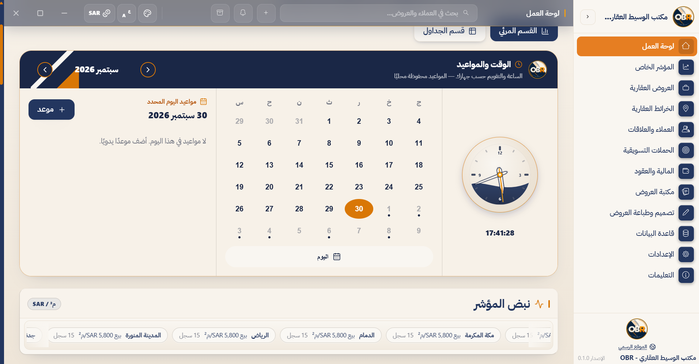
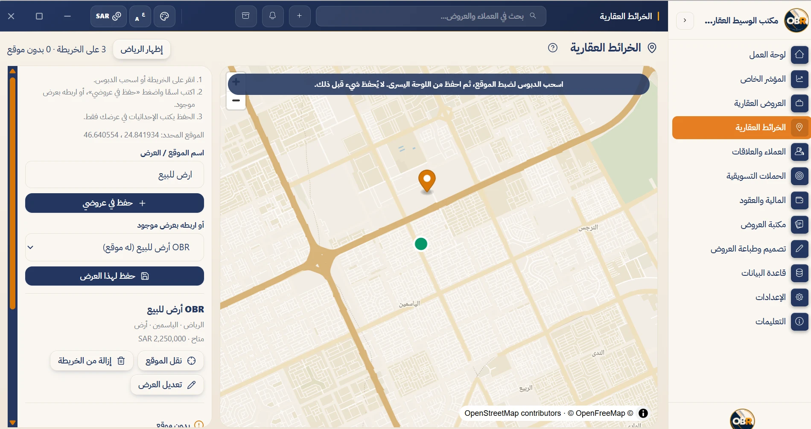
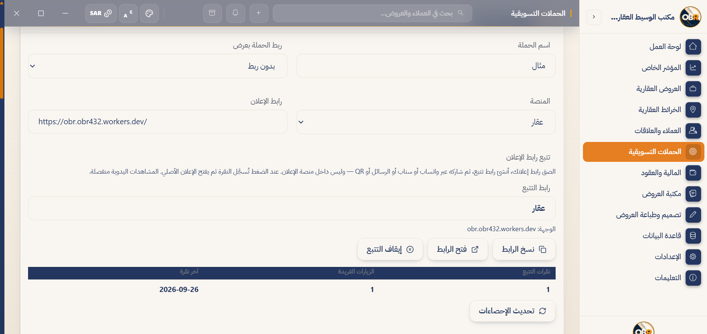
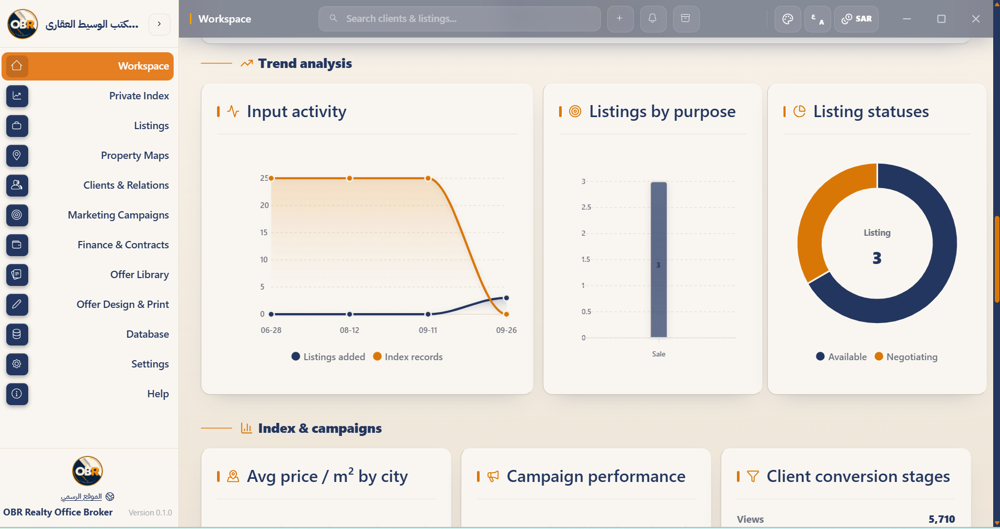

<div dir="rtl">

# تطبيق للوسيط والمسوق العقاري

**مكتب الوسيط العقاري - OBR** تطبيق مكتبي مفتوح المصدر لنظام Windows، صُمم لتنظيم أعمال الوساطة والتسويق العقاري في مكان واحد. واجهته **عربية وإنجليزية**، ومناسب لدول الخليج: **السعودية، والإمارات، والكويت، وقطر، والبحرين، وعُمان**.

[](LICENSE)

[](https://apps.microsoft.com/detail/9ncnpjc4f4v8)

يساعد التطبيق الوسيط العقاري على إدارة بيانات العملاء والعروض العقارية، ومتابعة السوق، وتنظيم الحملات التسويقية، وإدارة العقود والسجلات المالية، وحفظ المعلومات المهمة بطريقة مرتبة وسهلة الوصول.

**متوفر في متجر Microsoft:** [تنزيل مكتب الوسيط العقاري - OBR](https://apps.microsoft.com/detail/9ncnpjc4f4v8)



## أبرز المزايا

- لوحة تحكم لمتابعة أهم البيانات والأنشطة.
- مؤشر السوق الخاص لتسجيل وتحليل بيانات الأسعار والعروض والطلبات.
- إدارة العروض العقارية وتنظيم تفاصيلها.
- إدارة العملاء والعلاقات والمتابعة.
- أدوات للحملات التسويقية وتتبعها.
- إدارة العقود والسجلات المالية.
- مكتبة للعروض والملفات العقارية.
- دعم الخرائط والمواقع المرتبطة بالعقارات.
- أدوات مساعدة للتصميم وتجهيز المحتوى.
- دعم اللغتين العربية والإنجليزية.

يعمل التطبيق مستقلًا على Windows، وتُحفظ بيانات العمل التي يدخلها المستخدم محليًا على جهازه. لا يتطلب إنشاء حساب أو تسجيل دخول لاستخدام وظائفه الأساسية.

التطبيق مناسب للوسطاء والمسوقين العقاريين الذين يرغبون في تنظيم أعمالهم اليومية وبياناتهم العقارية ضمن واجهة واحدة عملية. وهو **مفتوح المصدر وقابل للتطوير**، والمساهمة في تطويره وتعديله مفتوحة للجميع.

| الخرائط العقارية | الحملات التسويقية |
|---|---|
|  |  |

## التقنيات المستخدمة

- [Tauri 2](https://tauri.app) وRust لنواة التطبيق.
- React وTypeScript وVite للواجهة (عربي RTL وإنجليزي).
- SQLite قاعدة بيانات محلية على جهاز المستخدم.
- MapLibre للخرائط، وApexCharts للرسوم البيانية.
- خدمة اختيارية لتتبع روابط الحملات في `tracking-endpoint/` (تعمل على Cloudflare Workers).

## التشغيل من المصدر

المتطلبات: Windows 10 أو أحدث، و[Node.js](https://nodejs.org) 20 أو أحدث، و[Rust](https://rustup.rs)، ومتطلبات [Tauri لنظام Windows](https://tauri.app/start/prerequisites/).

```bash
npm install
npm run dev:tauri
```

اختبارات Rust:

```bash
cd desktop/src-tauri
cargo test
```

بناء ملف التثبيت:

```bash
npm run build:tauri
```

ملف الخرائط دون اتصال اختياري ولا يُرفق بالمستودع بسبب حجمه؛ انظر `desktop/src-tauri/resources/maps/README.md`.

## المساهمة في التطوير

نرحب بالمساهمات: إصلاح الأخطاء، وإضافة الميزات، وتحسين الواجهة والترجمة والتوثيق، ودعم متطلبات دول الخليج. اقرأ [دليل المساهمة](CONTRIBUTING.md)، ثم افتح Issue أو Pull Request.

## الرخصة

التطبيق مرخص بموجب [رخصة Apache 2.0](LICENSE)، وتسمح بالاستخدام والتعديل والتوزيع، بما في ذلك الاستخدام التجاري، وفق شروطها. اسم «مكتب الوسيط العقاري - OBR» وشعار OBR يخصان OBR Group، والرخصة لا تمنح حق استخدامهما (البند 6 من الرخصة). انظر [NOTICE](NOTICE).

**الناشر:** OBR Group — الموقع: [obr.obr432.workers.dev](https://obr.obr432.workers.dev/)

</div>

---

# Real Estate Broker & Marketer App

**OBR Realty Office Broker** is an open-source Windows desktop application that brings real-estate brokerage and marketing work together in one place. The interface is **Arabic and English**, and it is suited to the Gulf countries: **Saudi Arabia, the UAE, Kuwait, Qatar, Bahrain and Oman**.

It helps brokers manage clients and property listings, follow the market, organize marketing campaigns, manage contracts and financial records, and keep important information organized and easy to reach.

**Available on the Microsoft Store:** [Get OBR Realty Office Broker](https://apps.microsoft.com/detail/9ncnpjc4f4v8)



## Key features

- A dashboard of the most important data and activity.
- A private market index to record and analyse prices, listings and requests.
- Property listing management.
- Client and relationship management with follow-up.
- Marketing campaign tools with link tracking.
- Contracts and financial records.
- A library of listings and property files.
- Maps and locations linked to properties.
- Design helpers for preparing marketing content.
- Arabic and English.

The application runs standalone on Windows and keeps the user's work data locally on the device. No account or sign-in is needed for its core features. It is **open source and extensible**, and contributions are welcome.

## Tech stack

Tauri 2 and Rust (core), React, TypeScript and Vite (Arabic RTL and English interface), SQLite (local database), MapLibre (maps), ApexCharts (charts), and an optional Cloudflare Workers service for campaign link tracking in `tracking-endpoint/`.

## Running from source

Requirements: Windows 10 or later, Node.js 20+, Rust, and the [Tauri prerequisites for Windows](https://tauri.app/start/prerequisites/).

```bash
npm install
npm run dev:tauri                      # run the app
cd desktop/src-tauri && cargo test     # Rust tests
npm run build:tauri                    # build the installer
```

The optional offline map file is not included because of its size; see `desktop/src-tauri/resources/maps/README.md`.

## Contributing

Bug fixes, features, interface, translation and documentation improvements, and support for Gulf-country requirements are welcome. Please read [CONTRIBUTING.md](CONTRIBUTING.md), then open an issue or a pull request.

## License

Licensed under the [Apache License 2.0](LICENSE), which permits use, modification and distribution, including commercial use, under its terms. The "OBR Realty Office Broker" name and the OBR logo belong to OBR Group and are not licensed for use (section 6 of the license). See [NOTICE](NOTICE).

**Publisher:** OBR Group — [obr.obr432.workers.dev](https://obr.obr432.workers.dev/)
